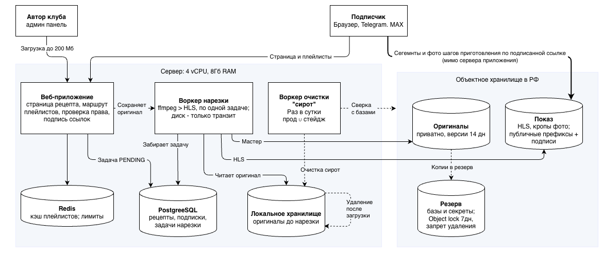
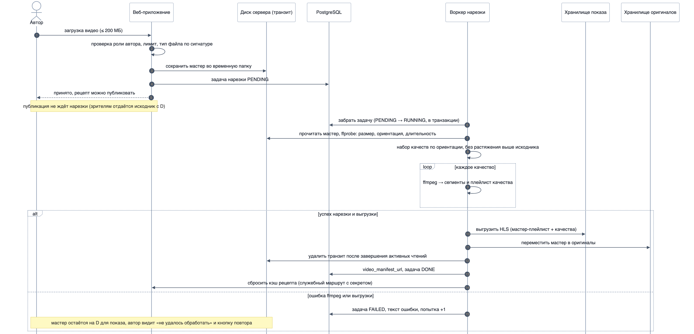
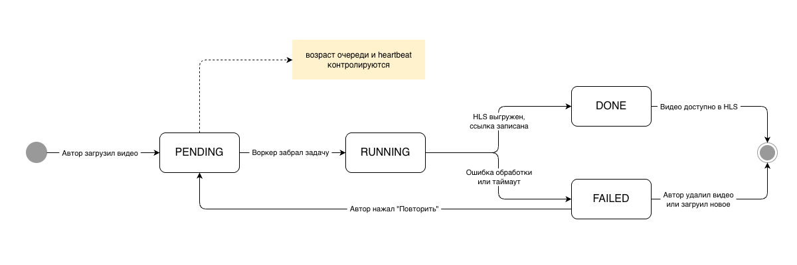
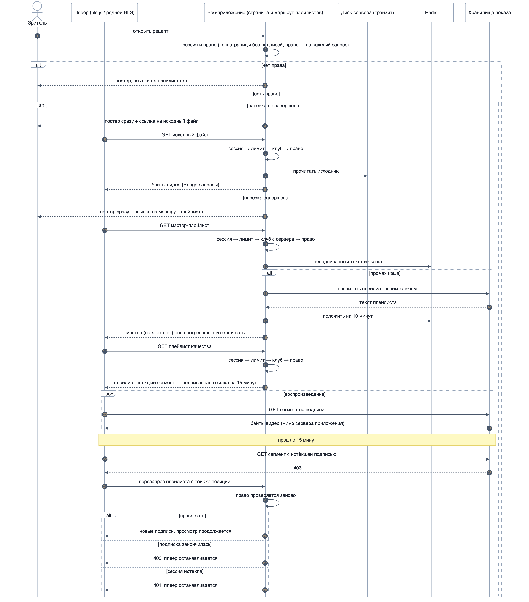
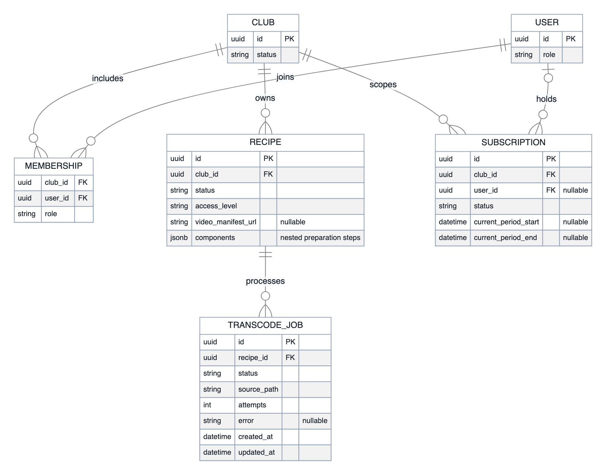

# Кейс 1. Видеоконтур платформы монетизации кулинарного контента

**Су-Шеф — учебно-практический проект, полный цикл системного анализа и AI-разработки.** Кейс описывает проектирование видеоконтура: требования, архитектурные решения и приёмку.

| | |
|---|---|
| **Продукт** | Облачная платформа, на которой автор кулинарного контента запускает свой закрытый клуб по подписке в мессенджерах Telegram и MAX: под своим брендом, без программирования.   Платформа принимает платежи, выдает чеки, добавляет/удаляет подписчиков в закрытый канал, хранит и показывает видеорецепты, работает как mini app в Telegram и MAX |
| **Предмет кейса** | Видеоконтур: как видеорецепт загружается, хранится, нарезается, защищается и показывается по шагам приготовления внутри Telegram и Max |
| **Заинтересованные стороны** | - автор клуба (владелец контента)  - подписчик клуба (зритель)  - оператор платформы (эксплуатация и затраты)  - провайдер объектного хранилища  - мессенджеры Telegram и Max (среда показа) |
| **Ограничения** | Текущая инфраструктура:  - один сервер 4 vCPU / 8 ГБ на прод и стейдж  - один воркер нарезки  - объектное хранилище без CDN  - хранение данных и медиа в РФ   - вход только через российские системы авторизации (149-ФЗ)  - контент клуба изолирован от пользователей другого клуба  Расчётный профиль испытаний — 100 клубов и ~30 000 подписчиков [расчёт](requirements/02-nfr-load.md#ёмкость-текущей-инфраструктуры-сколько-клубов-и-пользователей)|
| **Моя роль** | Все роли: продукт, системный анализ, архитектура, разработка, тестирование, эксплуатация.   Работал с AI-инструментами разработки: код писали агенты под моим контролем по процессу «research → design → plan → implementation → verification». Между фазами - compliance checker, после каждого шага - code review. По завершению имплементации - полный code review и compliance checker |

## Содержание

1. [Контекст](#контекст-зачем-автору-платформа-су-шеф).
2. [Задачи и ключевые решения](#задачи-и-ключевые-решения).
3. [User Stories](#user-stories).
4. [Use Cases](#use-cases).
5. [Требования и правила доступа](#требования-и-правила-доступа).
6. [Архитектура и взаимодействия](#архитектура-и-взаимодействия).
7. [ER-модель и словарь данных](#er-модель-и-словарь-данных).
8. [Нагрузка и НФТ](#нагрузка-и-нфт).
9. [Безопасность и сохранность](#безопасность-и-сохранность).
10. [Наблюдаемость](#наблюдаемость).
11. [API](#api).
12. [Приёмка и трассировка](#приёмка-и-трассировка).
13. [Результат проектирования](#результат-проектирования).

## Контекст: зачем автору платформа Су-Шеф

Когда повар развивается в своем деле как специалист, то рано или поздно его доход перестает заметно расти, потому что он привязан к личному времени и ресурсам. Рост дохода ограничен личным временем.

Обычно первая мысль — запустить свой онлайн-курс. Но запуск курса - это гипер активное ведение блога, прогревы, запуски, работа с методологом, запись уроков, и не один раз, а по кругу и без остановки.

Есть другой путь - основать клуб по подписке.

**Чего автору кулинарного контента не хватает и что дает платформа:**

| Боль | Решение |
|---|---|
| Закрытый канал в мессенджере плохо подходит для кулинарного контента, т.к. нет функционала поиска по фильтрам | платформа работает как mini app в мессенджере. Пользователь может перейти в канале к рецептам и найти нужный по фильтрам и названию |
| Прием платежей за подписку требует наличия ККМ с интернет-эквайрингом| платформа берет на себя прием платежей, выдачу чеков |
| Решение вопросов с оплатами, двойными списаниями, возвратами и т.п. | Платформа решает вопросы с продлениями и возвратами |
| Сложные и объемные требования 152-ФЗ, высокие штрафы за нарушения | платформа обеспечивает соответствие 152-ФЗ |
| удержание: подписчики уходят, если клуб — просто лента | видеорецепты с шагами, нутрициология, режим готовки, сообщество |
| привлечение: контент для соцсетей съедает время | партнёрская программа; закрытые каналы клуба в Telegram и Max |

**Видеорецепт — главный актив автора контента** на котором держится модель клуба по подписке. Поэтому сохранность видеоконтента, его защита от несанкционированного доступа и удобство пользователя при взаимодействии с видеорецептом - одни из главных приоритетов проекта.

Отсюда требования к видеоконтуру: видео должно начать воспроизводиться мгновенно при открытии рецепта, адаптироваться к доступной пропускной способности канала, показываться только тем, кто имеет право, и сохраняться в защищённом резерве при компрометации сервера.

## Задачи и ключевые решения

| # | Задача | Решение | Обоснование |
|---|---|---|---|
| 1 | **Мгновенное воспроизведение видеорецепта** | сначала рисуется постер (обложка) и ядро рецепта, тяжёлые секции догружаются потоком; плеер загружается отдельным кусочком кода; рецепт кэшируется и подгружается заранее при наведении на карточку | проектное решение |
| 2 | **Качество под канал зрителя** | фоновый воркер нарезает видео ffmpeg в HLS в профили до 1080p/720p/480p с сохранением ориентации и без увеличения разрешения исходника; hls.js выбирает качество по скорости, Safari и iOS играют HLS сами | проектное решение |
| 3 | **Доступ только по праву, защита от скрапинга** | плейлисты отдаёт свой маршрут приложения: проверка сессии и права на каждый запрос, при любой ошибке — отказ; сегменты и фото шагов — по подписанным ссылкам на 15 и 60 минут; бакет открыт анонимам только для публичных префиксов; лимит 100 запросов в минуту на пользователя | проектное решение |
| 4 | **Бесшовный просмотр дольше срока ссылки** | ссылка на сегменты живёт 15 минут, а готовка идёт 1,5–2 часа. Плеер на ошибке 403 сам перезапрашивает плейлист через тот же маршрут, право проверяется заново — зритель страницу не обновляет | проектное решение |
| 5 | **Пошаговый просмотр** | шаг приготовления ссылается на отрезок основного видео `{startSec, endSec}`; автор размечает отрезок в редакторе; фото шага и отрезок взаимоисключающие | единая модель шага и отрезка видео |
| 6 | **Просмотр внутри Telegram и Max** | клуб открывается как мини-приложение мессенджера: то же веб-приложение во встроенном браузере, тот же плеер и тот же контроль доступа; вход — e-mail или Яндекс ID (149-ФЗ); бот доступа впускает подписчика в закрытый канал клуба | проектное решение |
| 7 | **Видео не удаляется, даже при взломе сервера** | три класса хранения: показ (производные копии), оригиналы (приватно, с версиями), резерв (отдельный бакет с Object Lock и запретом удаления); у каждого бакета свой ключ; очистка «сирот» с пятью защитами от ошибочного удаления | проектное решение |

Обоснование выбора (в [безопасности](requirements/03-security.md#почему-подписанные-ссылки)):

- **Свои хранилище и нарезка, а не внешний видеохостинг.** Видео — платный контент клуба, его нельзя отдавать по публичной
  ссылке чужого сервиса; данные и медиа должны оставаться в РФ; хранилище оплачивается по нагрузке, а своя нарезка
  на своем воркере не несет дополнительных затрат.
- **Подписанные ссылки, а не шифрование сегментов (HLS AES-128).** Один механизм закрывает и видео, и фото шагов, не нужен
  новый секрет и перенарезка всех опубликованных видео.
- **Основной трафик HLS идёт напрямую из хранилища.** Сервер отдаёт только плейлисты — килобайты текста. Сегменты зритель берёт
  из хранилища напрямую. Исключение — защищённая выдача исходника до готовности HLS: она использует диск и канал сервера.
- **CDN пока нет.** Медиа отдаётся прямо из объектного хранилища. Подключение CDN привязано к метрике: трафик из хранилища
  больше 50 ГБ в месяц. [Расчёт порога](requirements/02-nfr-load.md#когда-понадобится-cdn).

## User Stories

Истории связывают цели автора, зрителя и оператора с требованиями. Для автора важна публикация без ожидания нарезки,
для зрителя — непрерывный просмотр и переходы по шагам, для оператора — сохранность контента и контроль затрат.
У каждой истории есть критерии приёмки и ссылки на сценарии проверки.

[User Stories и критерии приёмки →](requirements/05-user-stories.md)

## Use Cases

Пять сценариев раскрывают путь видео: загрузка и публикация, разметка отрезка, просмотр, пошаговая готовка и восстановление.
Для каждого заданы актор, триггер, предусловия, результат и альтернативы. Например, ошибка нарезки сохраняет возможность
показа исходника, а истечение права останавливает выдачу новых ссылок независимо от состояния плеера.

[Основные и альтернативные потоки →](requirements/06-use-cases.md)

## Требования и правила доступа

Бизнес-требования разложены на поведение системы: независимую загрузку ядра страницы, фоновую нарезку, выдачу медиа по праву
и навигацию по шагам. Матрица доступа различает участника, подписчика, автора своего клуба и администратора.
В кейсе приведены выдержки требований, включая пример приёмки воспроизведения отрезка.

[Требования, матрица доступа и правила доставки →](requirements/01-requirements.md)

## Архитектура и взаимодействия

### Контейнеры видеоконтура (C4, уровень 2)

**Вывод:** после нарезки сегменты идут из объектного хранилища напрямую. До готовности HLS сервер выдаёт транзитный исходник через защищённый Range-маршрут. Приватные оригиналы и резерв отделены от контура показа.

**Архитектурные риски:**
- Единая точка отказа (SPOF) на одном сервере: Веб-приложение, воркер нарезки, воркер очистки, Redis
и PostgreSQL живут на одной машине.
- При пиковой нагрузке на ffmpeg (CPU 100%) или утечке памяти в воркере начнут тормозить
ответы веб-приложения и база данных. Перед первыми пользователями рекомендуется жестко ограничить ресурсы воркера через Docker
(--cpus="2" или nice), чтобы оставить минимум 2 ядра под веб-сервер и БД.
- У S3-хранилища есть лимиты на количество запросов в секунду (RPS) и более высокая задержка (TTFB) при старте первого сегмента, чем у CDN. На старте прямой S3 допустим, но при росте трафика может пострадать требование мгновенного старта видео.

### Загрузка и нарезка (UML sequence)

**Вывод:** публикация рецепта не ждёт нарезки, а оригинал попадает в приватное хранилище до того, как удаляется временная копия.

### Состояния задачи нарезки (UML state)

**Вывод:** до готовности HLS зрителю доступен защищённый исходник. Ошибка переводит задачу в FAILED, повтор — в PENDING; очередь и пульс воркера контролируются по [ТЗ на наблюдаемость](requirements/04-observability.md).

### Просмотр: проверка права, сегменты, бесшовная переподпись (UML sequence)

**Вывод:** право проверяется не один раз при открытии страницы, а на каждом запросе плейлиста, в том числе при
переподписи. Пересланная ссылка умирает через 15 минут: получатель без подписки новую подпись не получит.

## ER-модель и словарь данных

**Вывод:** клуб ограничивает область данных и права зрителя; задачи обработки принадлежат рецепту, а шаги и таймкоды
хранятся внутри его JSONB-документа. [Связи, кардинальности и инварианты](data/README.md).

## Нагрузка и НФТ

Расчёт начинается с аудитории одного автора: медиана около 300 подписчиков, верхняя граница — около 2 000.
Отдельно рассматриваются средняя конкурентность и всплеск после публикации. Из профиля просмотра выводятся трафик,
условия подключения CDN и нагрузка на приложение; НФТ задают измеримые пороги старта, буферизации и обработки видео.

[Допущения, расчёты, НФТ и деградация →](requirements/02-nfr-load.md)

## Безопасность и сохранность

Контроль доступа разделён между приложением и хранилищем: приложение проверяет право, хранилище принимает короткоживущую
подпись. Для оригиналов и резервных копий заданы отдельные права и правила хранения. Модель угроз описывает прямой доступ,
пересылку ссылок, межклубную изоляцию и пределы защиты полученного контента.

[Модель угроз, выбор механизма и восстановление →](requirements/03-security.md)

## Наблюдаемость

Наблюдаемость охватывает качество просмотра, ошибки доставки, очередь нарезки, свежесть резерва и расход ресурсов.
ТЗ задаёт метрики, пороги алертов, состав событий и проверки: оператор должен получить сигнал с контекстом клуба,
рецепта и задачи, не раскрывая подписи и ключи доступа.

[Метрики, алерты, дашборд и приёмка →](requirements/04-observability.md)

## API

Контракт плейлистов определяет параметры запроса, проверки права, коды ошибок и запрет кэширования подписанных ответов.
Отдельно описана временная выдача исходника с Range до готовности HLS. Это связывает пользовательский сценарий просмотра
с последовательностью запросов на диаграмме.

[Описание контрактов →](api/README.md) · [OpenAPI →](api/openapi.yaml)

## Приёмка и трассировка

Сценарии проверяют загрузку, доступ, адаптацию качества, обновление ссылок, пошаговый просмотр и восстановление.
Трассировка связывает бизнес-задачу с требованием и проверкой, а также показывает связи User Stories и Use Cases.
Так можно пройти от цели пользователя до конкретного ожидаемого результата системы.

[Сценарии приёмки →](tests/test-cases.md) · [Трассировка BR → FR → TC →](tests/traceability.md)

## Результат проектирования

Определены путь видео от загрузки до просмотра, границы доступа, модель фоновой обработки и восстановление после сбоев.
Публикация рецепта не зависит от завершения HLS: до готовности используется защищённый исходник. После нарезки тяжёлый
трафик вынесен в объектное хранилище, а приложение контролирует право и выдаёт короткоживущие ссылки.

Требования связаны с моделями, API, НФТ и сценариями приёмки. Наблюдаемость включает пользовательское качество просмотра,
очередь обработки и расход ресурсов. Расчёты нагрузки задают условия испытаний и подключения CDN.
