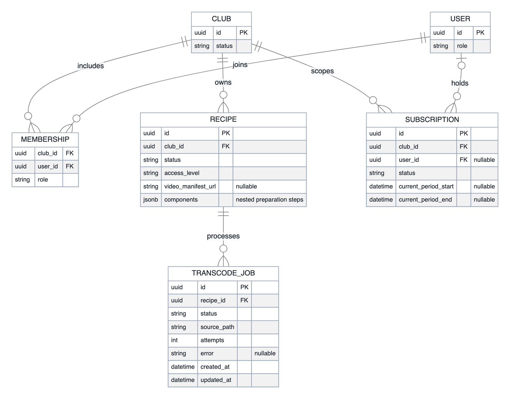

# ER-модель видеоконтура

[← к кейсу](../README.md) · [требования](../requirements/01-requirements.md) · [Use Cases](../requirements/06-use-cases.md)



[Исходник Mermaid](../diagrams/er-model.mmd) · [SVG](../diagrams/er-model.svg)

Логический фрагмент модели данных: принадлежность рецепта клубу, членство и право зрителя, очередь обработки видео.
Показаны только поля, необходимые для видеоконтура. Имена сущностей сокращены: `MEMBERSHIP` соответствует
`club_memberships`; регистр значений перечислений в тексте унифицирован для чтения.

## Связи и правила целостности

| Связь | Кардинальность и правило |
|---|---|
| Клуб → рецепт | у клуба 0…N рецептов; каждый рецепт принадлежит ровно одному клубу |
| Пользователь ↔ клуб | связь M:N через членство; пара `(club_id, user_id)` уникальна; роль определяется в конкретном клубе |
| Клуб → подписка | каждая подписка относится к одному клубу; право на PRO-рецепт другого клуба не возникает |
| Пользователь → подписка | у пользователя 0…N исторических подписок; ссылка nullable, поскольку запись подписки переживает удаление аккаунта |
| Рецепт → задача нарезки | у рецепта 0…N задач; задача относится ровно к одному рецепту, удаляется каскадно вместе с ним |

Роль администратора хранится у пользователя. Роль автора — в членстве клуба; привилегия автора действует только
в собственном клубе. Членство само по себе открывает REGISTERED-рецепты, но не PRO.

Текущая подписка и действующее право различаются: право вычисляется по состоянию и границам периода на момент запроса.
У участника клуба не более одной текущей подписки в состояниях TRIAL/ACTIVE/PAST_DUE; исторических EXPIRED может быть много.
Для ACTIVE обе границы оплаченного периода обязательны, конец позже начала; конец периода не включается в интервал доступа.
Полное правило активности задаёт доменный предикат подписки, а не проверка одного `status` в плеере.

`video_manifest_url` — неподписанный serving URL мастер-плейлиста, записываемый воркером после выгрузки HLS.
Клиент получает маршрут приложения, а не прямой доступ к этому объекту. Подписи создаются на запрос и в таблицах
и общем кэше не сохраняются. `source_path` задачи указывает на транзитный файл для обработки и временного защищённого показа.
Клуб задачи определяется через рецепт: дублировать `club_id` у задачи для этой связи не требуется.

## Вложенная модель шага

Шаги входят в `Recipe.components` (JSONB). Это композиция внутри документа рецепта, отдельной таблицы `steps` нет.
Порядок шагов определяется порядком элементов в блоке приготовления.

```json
{
  "id": "step-2",
  "imageUrl": null,
  "imageOriginalUrl": null,
  "videoSegment": { "startSec": 75, "endSec": 100 }
}
```

Пример показывает только медиаполя шага; идентификатор условный. Таймкоды — целые секунды.
Правила: `0 ≤ startSec < endSec`; выбор отрезка ограничен длительностью основного видео; фото шага и отрезок
взаимоисключающие. `videoSegment = null` означает отсутствие фрагмента. Фрагмент ссылается на основное видео рецепта,
а не на самостоятельный загруженный видеофайл (US-2, UC-2, TC-21).

При замене основного видео автор повторно проверяет привязанные таймкоды до публикации: диапазон не должен выходить
за длительность нового файла. Проверка записи медиаполей выполняется на сервере, независимо от редактора.

## Хранилище объектов

HLS-сегменты, оригиналы и резервные копии находятся в объектном хранилище, поэтому не показаны отдельными SQL-таблицами.
Ключ объекта связывает медиа с клубом и рецептом: `clubs/{clubId}/…/{recipeId}/…`.
Защищённый исходник до HLS и приватный оригинал различаются по месту и способу выдачи; доступ к исходнику идёт
через приложение с Range, доступ к приватному оригиналу имеет только серверный контур.

Повтор обработки использует существующий транзитный исходник и переход FAILED → PENDING в проектной модели кейса.
Публикация рецепта и состояние обработки независимы: опубликованный рецепт может иметь задачу PENDING/RUNNING/FAILED,
при этом зрителю с правом доступен исходник (UC-1, UC-3).
