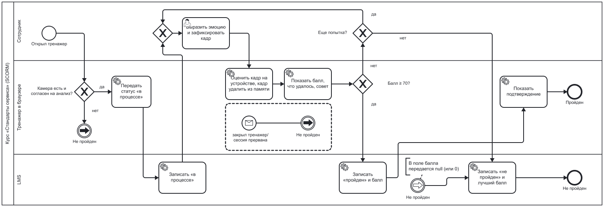
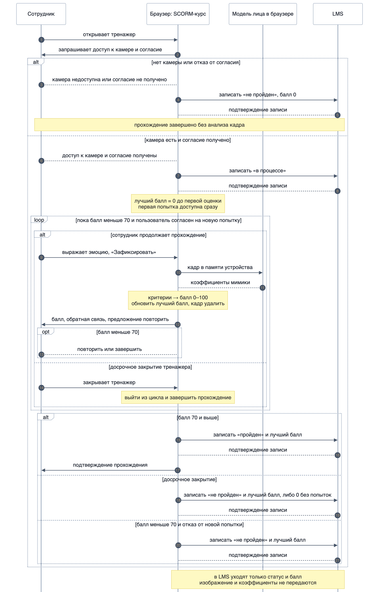
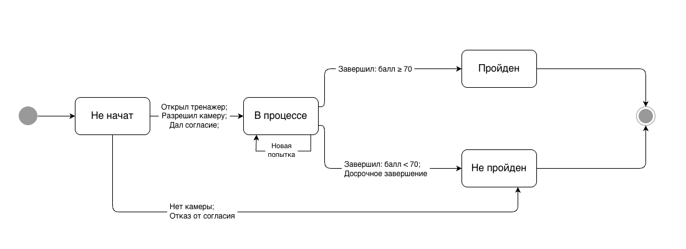
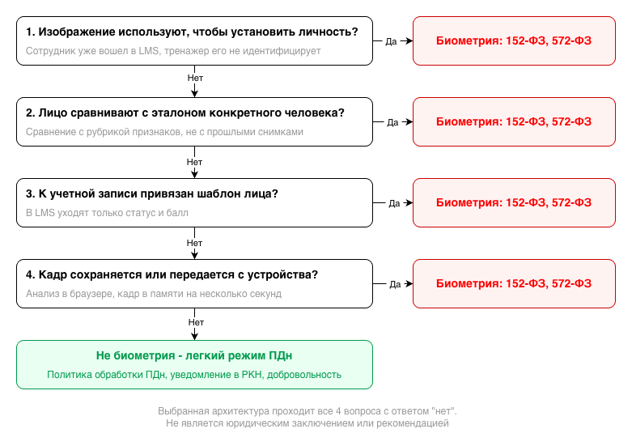

# Кейс 2. AI-тренажер эмоций для сотрудников магазинов

**Реальный пресейл · федеральный ритейлер · суть тренажера скорректирована в рамках NDA, заказчик обезличен.**

Правовая часть явлется анализом требований, и не является юридическим заключением. Цены, названия систем и имена не приводятся.

| | |
|---|---|
| **Задача** | Тренажер в корпоративном курсе: сотрудник выражает эмоцию на камеру, система оценивает эмоцию и дает совет, результат попадает в LMS |
| **Ограничения из ТЗ** | Работа с ПК и смартфонов; 1 500–2 000 одновременно; ответ ≤ 3 с; проходной балл ≥ 70 %; в LMS — статусы «пройден / в процессе / не пройден» |
| **Заинтересованные стороны** | Отдел обучения (заказчик),  руководство (инициатор),  сотрудники магазинов (пользователи),  служба безопасности (согласует обработку изображений),  корпоративная LMS (получатель статусов) |
| **Моя роль** | Анализ требований и проектирование решения на этапе пресейла: процесс, интеграция с LMS, НФТ, варианты архитектуры, правовой режим |
| **Итог** | Заказчик не возражал ни против архитектуры, ни против правовой логики, но решил делать своими силами: по его словам, из-за цены и отсутствия бюджета |

## Содержание

1. Таблица выше и [контекст](#контекст) — задача, ограничения из ТЗ, заинтересованные стороны.
2. [Роль и задача](#роль-и-задача) — какие проблемы нашел в требованиях до проектирования.
3. [Ключевые решения](#ключевые-решения) — 6 решений с обоснованиями.
4. [BPMN](#процесс-прохождения-bpmn-20) → [sequence](#взаимодействие-курса-и-lms-uml-sequence) → [state](#состояния-прохождения-uml-state) — процесс и поведение тренажера.
5. [Контракт данных с LMS](#контракт-данных-с-lms) и [НФТ](#нефункциональные-требования) — интеграция и пороги с источником.
6. [Варианты архитектуры](#варианты-архитектуры) → [дерево решений по 152-ФЗ](#правовой-режим-дерево-решений-по-ст-11-152-фз) — почему выбран анализ в браузере.
7. [Открытые вопросы](#открытые-вопросы-к-заказчику) → [результат](#результат) → [что сделал бы иначе](#что-сделал-бы-иначе).

## Контекст

В программе обучения сотрудников есть блок про определенные эмоции, которые выражаются через мимику. Отдел обучения хотел, чтобы сотрудник мог отработать навык и получить обратную связь, а результат попадал в корпоративную LMS. Запрос пришел от отдела обучения, инициатива от руководства.

Распознать эмоцию несложно. Нюанс в том, чтобы встроить это в обучение 2000 человек так, чтобы это не попадало под режим обработки биометрии.

В исходных требованиях фокус был на бизнес-логике. Риск по биометрии **не входили в исходное ТЗ**, но были выявлен мной на этапе проработки архитектуры.

## Роль и задача
**Роль:** Менеджер по продажам, пресейсл, системный анализ, архитектура.

**Исходная задача:** Оценить и спроектировать AI-тренажер эмоций под ФТ заказчика.

**Уточненная задача:** В процессе пресейл-аудита расширил рамки ТЗ, добавив критически важное требование по комплаенсу - разработать архитектуру, которая исключает сбор и хранение биометрических данных, не удорожая при этом внедрение.

Что нашел в требованиях до проектирования:

| Проблема | Что сделал |
|---|---|
| «Искренность эмоции» не измеряется, признак «комплексной эмоции» — это эвристика | переформулировал требование в «индикатор вовлеченности глаз» и обозначил заказчику, в каких сценариях могут быть погрешности |
| не существует эталона «правильной» эмоции. Без эталона не понятно, как рассчитать балл | рубрику признаков дает исполнитель, 300–500 размеченных примеров — тренеры заказчика, веса критериев — решение заказчика |
| 2 000 человек с видеопотоком на сервер — это GPU-инфраструктура | вынес анализ на устройство (см. решения) |
| анализ лица имеет риск попадания под режим обработки биометрии | проанализировал, когда обработка лица считается биометрией, и выбрал архитектуру, при которой обработка изображения лица не является обработкой биометрии |

## Ключевые решения

1. **Анализ изображения в браузере, изображение не покидает устройство.** Модель лица (MediaPipe Face Landmarker) дает 52 коэффициента мимики. Из них по рубрике считаются критерии: "эмоция", симметрия, открытость, вовлеченность глаз, контакт с камерой. Взвешенная сумма дает балл 0–100. Снимок находится в памяти устройства несколько секунд, после чего удаляется.
2. **Курс — статичный SCORM-пакет без серверной части.** Поэтому 2 000 одновременных пользователей не требуют инфраструктуры, а ответ — доли секунды вместо допустимых 3 с.
3. **Правовой режим выбран архитектурой.** По ст. 11 152-ФЗ биометрия — это данные, по которым устанавливают личность. Если нет идентификации, сравнения с эталоном и хранения, то это не биометрия. Тогда особое согласие на биометрию и 572-ФЗ не применяются.
4. **«В процессе» ставится после получения доступа к камере и согласия.** Отказ на старте или досрочное завершение фиксируются как «не пройден»; без оценённых попыток передаётся балл 0, иначе лучший балл.
5. **Тяжелые варианты — опции, а не основа.** Точная оценка мимики на сервере и текстовый разбор нейросетью предложены как опции на случай, если браузерной точности не хватит. Каждая тянет за собой серверный контур ПДн.

## Артефакты

### Процесс прохождения AI-тренажера (BPMN 2.0)

Сотрудник, тренажер в браузере и LMS. При отсутствии камеры или согласия прохождение завершается статусом «не пройден» и баллом 0. Попыток сколько угодно. **Вывод:** в LMS уходят только статусы и балл.
Исходник: [trainer.bpmn](bpmn/trainer.bpmn) (открывается в [demo.bpmn.io](https://demo.bpmn.io/) или Camunda Modeler).

### Взаимодействие курса и LMS (UML sequence)

**Вывод:** у решения нет серверной части для анализа, поэтому нагрузка на заказчика не зависит от числа сотрудников. Исходник: [sequence-scorm.mmd](diagrams/sequence-scorm.mmd).

### Состояния прохождения (UML state)

Три статуса из ТЗ. **Вывод:** «не пройден» — не приговор, сотрудник может вернуться и пройти заново. Исходник: [attempt-states.drawio](diagrams/attempt-states.drawio).

### Контракт данных с LMS

Версию SCORM заказчик не подтвердил (открытый вопрос), поэтому указаны обе.

| Данные | SCORM 1.2 | SCORM 2004 | Когда |
|---|---|---|---|
| Статус «в процессе» | `cmi.core.lesson_status = incomplete` | `cmi.completion_status = incomplete` | камера доступна и согласие получено |
| Пройден | `cmi.core.lesson_status = passed` | `cmi.success_status = passed` | балл ≥ 70 |
| Не пройден | `cmi.core.lesson_status = failed` | `cmi.success_status = failed` | отказ на старте, досрочное закрытие или завершение с баллом < 70 |
| Итоговый балл | `cmi.core.score.raw = bestScore`, 0–100 | `cmi.score.scaled = bestScore / 100`, 0–1 | при завершении прохождения, вместе с итоговым статусом |
| Отсутствие оценённых попыток | `cmi.core.score.raw = 0` | `cmi.score.scaled = 0` | отказ на старте или выход до первой оценки |
| Изображение лица | не передается | не передается | никогда |

После каждой оценённой попытки браузер обновляет `bestScore = max(bestScore, score)` локально.
Промежуточные баллы в LMS не передаются. При успешном завершении передаются «пройден» и лучший балл;
при досрочном закрытии или отказе от новой попытки — «не пройден» и лучший балл.
Если оценённых попыток не было, итоговый балл равен 0.

### Нефункциональные требования

| Требование | Порог | Источник |
|---|---|---|
| Одновременные пользователи | 1 500–2 000 | ТЗ |
| Время ответа | ≤ 3 с; в выбранном варианте — доли секунды | ТЗ; оценка решения |
| Браузеры | Chrome 90+, Firefox 88+, Safari 14+, Edge 90+ | ТЗ |
| Устройства | ПК и смартфоны с камерой (iOS, Android) | ТЗ |
| Хранение изображений | не хранятся и не покидают устройство | правовой анализ |
| Устойчивость оценки | калибровка на 300–500 примерах, проверка на разных лицах и освещении | риск, заложенный в оценку |

### Варианты архитектуры

| Вариант | Где изображение? | Инфраструктура на 2 000 человек | Правовой режим | Что дает |
|---|---|---|---|---|
| **A. В браузере — выбран** | не покидает устройство | не нужна: курс — статичный пакет | базовый режим ПДн | эмоции, симметрия, открытость, вовлеченность глаз, контакт с камерой |
| B. Точная оценка мимики на сервере | уходит на сервер | GPU, автомасштабирование | согласие, хранение в РФ, шифрование, удаление | исследовательская точность |
| C. Текстовый разбор нейросетью на сервере в РФ | уходит на сервер | GPU | то же + ограничения на ответы модели | более живые советы; балл все равно считает браузер |

### Правовой режим: дерево решений по ст. 11 152-ФЗ

**Вывод:** вариант A отвечает «нет» на все 4 вопроса. Исходник: [decision-tree.drawio](diagrams/decision-tree.drawio).

Требования из варианта A: изображения не покидают устройство и не хранятся; наружу уходят только статус и балл; балл не сопоставляется с изображением лица; интерфейс прямо говорит, что снимок никуда не отправляется.

Запрещено требованиями:
- сохранять изображения «для улучшения модели»;
- отправлять изоборажение на сервер без отдельного правового контура;
- сравнивать с прошлыми снимками сотрудника (это сопоставление с эталоном);
- проводить идентификацию сотрудника по лицу на входе в тренажер.

### Открытые вопросы к заказчику

| Вопрос | На что влияет |
|---|---|
| Какой движок LMS и какая версия SCORM, есть ли xAPI? | объем интеграции и контракт данных |
| Кто разметит 300–500 примеров «удачно / неудачно»? | калибровка балла; без них оценка произвольна |
| Какие веса у критериев? | бизнес-решение заказчика на основе нашей рубрики |
| Какова позиция службы безопасности/юридического департамента по анализу лица в браузере без хранения? | подтверждение варианта A |

## Результат

Бизнес-эффект измерить нельзя: проект не был реализован нашей командой. Заказчик решил разрабатывать самостоятельно. Ниже — что решение давало заказчику по сравнению с «лобовым» вариантом (видео на сервер).

| Показатель | Лобовой вариант (B) | Решение (A) | Источник / статус |
|---|---|---|---|
| Серверная инфраструктура под 2 000 одновременных | GPU и автомасштабирование | не нужна | архитектурная оценка |
| Время ответа | зависит от загрузки сервера | доли секунды на устройстве | оценка; на устройствах заказчика не измерено |
| Изображений, покидающих устройство | все | 0 | следует из архитектуры |
| Правовой режим | серверный контур ПДн, риск биометрии | базовый режим ПДн | анализ требований |

**Границы доказательств.** Точность оценки эмоции не проверялась на данных заказчика: разметки не было. Время ответа в браузере — оценка, и не является замером на парке устройств заказчика. Вывод о биометрии — является результатом анализа требований, а не заключением юриста.

## Что сделал бы иначе

1. **Разделил бы пресейл-экспертизу на два этапа**

Бесплатная концепция с демонстрацией рисков и платный архитектурный аудит, чтобы не отдавать готовое ноу-хау до подписания контракта.
