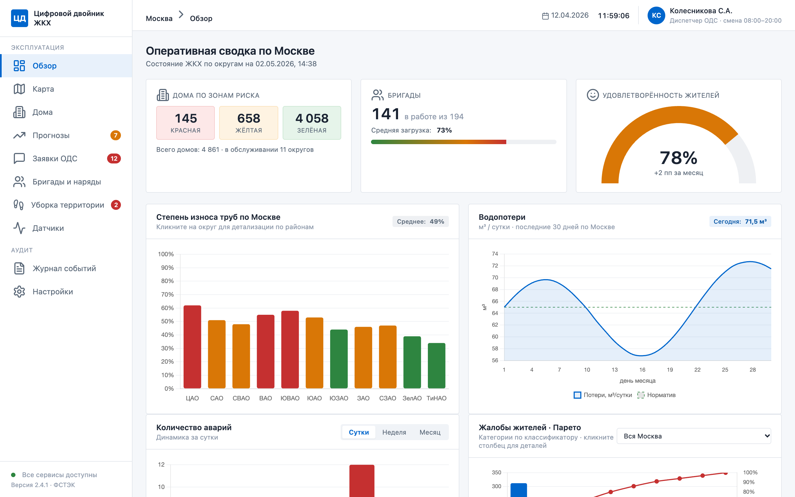
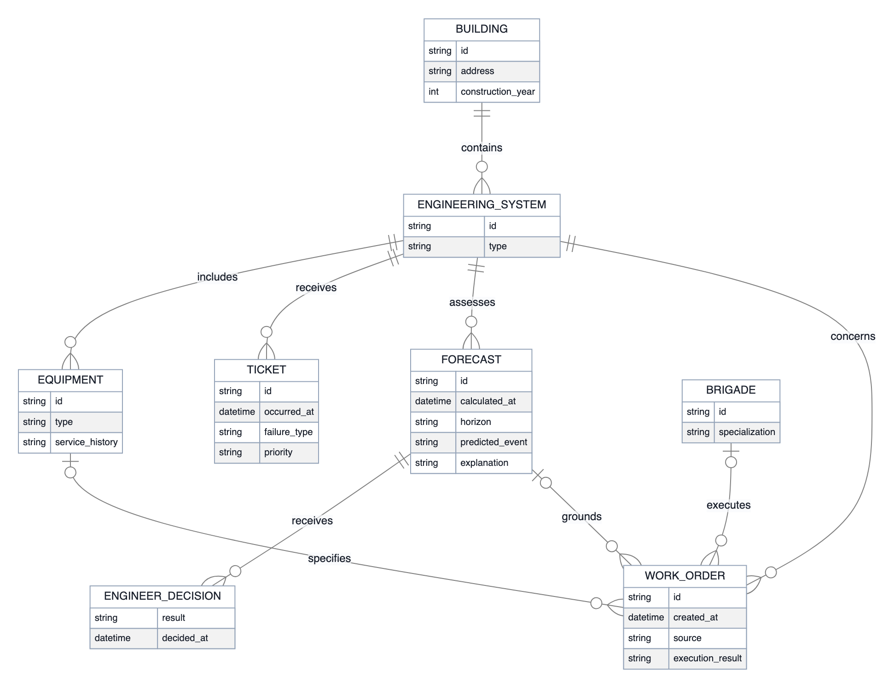
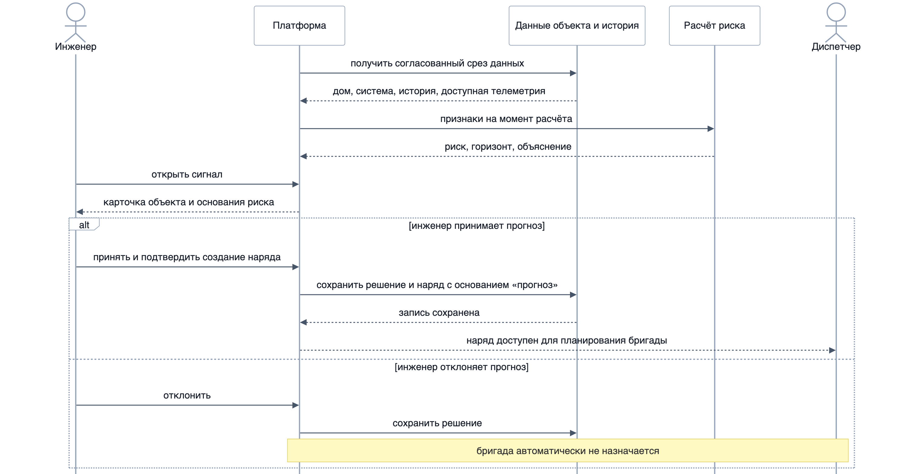

# Кейс 3. Цифровой двойник ЖКХ Москвы: от прогноза риска к превентивным работам

**Реальный предпроект по запросу Мосстратегии (Департамент экономической политики и развития Москвы)· концепция и кликабельный прототип.**

**По запросу предоставлю контакт в департаменте экономической политики и развития Москвы для валидации кейса.**

| | |
|---|---|
| **Запрос** | Мосстратегия обратилась с запросом проработать проект цифрового двойника жилого фонда Москвы в целях реализации требований распоряжения Правительства РФ от 2 марта 2026 г. №398-р в части цифровой трансформации строительства и ЖКХ до 2030 года |
| **Заказчик и пользователи** | Мосстратегия — инициатор;  Территориальные органы управления — потенциальные заказчики;  Диспетчер, инженер и руководитель районной службы — пользователи |
| **Моя роль** | Исследование мирового опыта цифровых двойников городов, системный анализ, формирование концепции, постановка задачи прогноза, метрики, проектирование пользовательских сценариев и прототип с AI-инструментами, пресейл. Архитектуру и оценку разработки обсуждал с экспертами ЖКХ и цифровых двойников |
| **Период** | Апрель–май 2026 года — проработка; Июнь 2026 года — представление концепции префектурам САО и ЦАО Москвы и дирекции ЖКХ Москвы |
| **Результат** | Концепция, метрики и прототип для обсуждения. В разговоре с префектуарми выявлена более близкая потребность — контроль уборки территории; соответствующий раздел добавлен в прототип |
| **Граница кейса** | Требования и логическая модель концепции, путь «сигнал → решение инженера → наряд», требования к данным и проверке прогноза. Все данные прототипа демонстрационные |

## Содержание

1. [Контекст и задача](#контекст-и-задача).
2. [Интерфейс и кликабельный прототип](#интерфейс-и-кликабельный-прототип).
3. [Требования и сценарии](#требования-и-сценарии).
4. [Данные и интеграции](#данные-и-интеграции).
5. [Взаимодействие пользователя и системы](#взаимодействие-пользователя-и-системы).
6. [Прогноз и метрики](#прогноз-и-метрики).
7. [Приёмка](#приёмка).
8. [Результат проектирования](#результат-проектирования).

## Контекст и задача

Распоряжение Правительства РФ от 2 марта 2026 г. №398-р утвердило обновленное стратегическое направление цифровой
трансформации строительства и ЖКХ до 2030 года. Документ определяет приоритетные задачи: формирование единой базы
объектов коммунальной инфраструктуры с электронными паспортами, повышение эффективности организаций ЖКХ через
автоматизированные системы управления, внедрение стандартов «умного дома».

Сейчас паспорта домов, оборудование, обращения жителей и история ремонтов существуют в разных системах. Необходимо
было сформулировать продукт — платформу, которая собирает данные о домах в одну карточку, показывает состояние каждого
дома «светофором» и прогнозирует отказы инженерных систем.

В июне 2026 года концепция была представлена в префектуры САО и ЦАО Москвы и Дирекцию ЖКХ Москвы.

При обсуждении проекта появились дополнительные вводные, что ближайшая потребность потенциальных заказчиков — контроль
уборки территорий: местоположение исполнителей и техники, план/факт маршрутов, простои и покрытие участка. В результате
обсуждения прототип добавлен мониторинг уборки. Прогноз отказов остаётся отдельной задачей, для которой сначала нужно
подтвердить качество и достаточность истории данных.

## Интерфейс и кликабельный прототип

**[Открыть кликабельный прототип →](https://massimo-pazzi.github.io/housing-digital-twin-case/demo/)**

Обзорный экран объединяет состояние домов по зонам риска, загрузку бригад и эксплуатационные показатели.
Через меню можно перейти к карте, карточкам домов, прогнозам, заявкам, нарядам и мониторингу уборки.
Прототип использовался для обсуждения концепции и пользовательских сценариев.

Все адреса, имена, показатели и события в прототипе демонстрационные; числа на экране не являются результатами внедрения.

**[Открыть кликабельный прототип →](https://massimo-pazzi.github.io/housing-digital-twin-case/demo/)**

## Требования и сценарии

Бизнес-задача разложена на карточки объектов, приоритизацию риска, решение инженера и основание наряда.
В требованиях отдельно закреплена обработка неполных данных: отсутствие измерений не означает исправность оборудования.
Для уборки используется самостоятельный набор показателей маршрута и участка, без смешивания с качеством прогноза отказов.

[Выдержки BR/FR и пользовательские сценарии →](requirements/01-requirements.md)

## Данные и интеграции

Модель связывает дом, инженерную систему, оборудование, заявки, прогнозы, решения инженера и наряды.
Наряд относится к системе дома; оборудование указывается, если его можно достоверно определить. Это позволяет
использовать историю обращений без вымышленной точности до конкретного насоса.

[Сущности, кардинальности и инварианты →](data/README.md) · [исходник ER](diagrams/er-model.mmd)

Интеграционная постановка определяет смысл передаваемых данных, требования к привязке объектов, времени события,
качеству и происхождению. Конкретные протоколы и контракты систем-источников уточняются при аудите данных.

[Границы систем, обмен и требования к качеству данных →](requirements/02-data-and-integration.md)

## Взаимодействие пользователя и системы

Инженер получает объяснимый сигнал и проверяет контекст; принятый прогноз становится основанием превентивного наряда.
Отклонение сохраняется как обратная связь. Сам по себе высокий риск не меняет статус оборудования на «авария».

[Основной сценарий и альтернативы →](requirements/01-requirements.md#uc-1-рассмотреть-прогноз-и-назначить-работу) · [исходник sequence](diagrams/sequence-prevention.mmd)

## Прогноз и метрики

Главная метрика — доля превентивных работ, отдельно от календарного обслуживания. Продукт должен менять выбор работ,
а не только визуализировать историю. Для прогноза важны точность верхней части списка, полнота критических отказов
и время упреждения. Числа на экранах прототипа не являются результатом испытаний модели.

[Постановка прогноза, метрики и условия ретроспективного теста →](requirements/03-forecast-and-metrics.md)

## Приёмка

Сценарии проверяют связность карточки, основания наряда, решение инженера и корректность расчёта метрик.
Отдельные проверки посвящены неполным данным и временному разделению выборки, чтобы не завысить оценку модели.

[Сценарии и трассировка BR → FR → TC →](tests/acceptance.md)

## Результат проектирования

Сформирована концепция платформы, определены пользователи и решения, которые она поддерживает, поставлена задача
проверяемого прогноза и предложен критерий допуска к дальнейшей разработке. Создан кликабельный прототип с карточками
домов, прогнозами, заявками, бригадами и мониторингом уборки. Концепция представлена потенциальным заказчикам.

Измеренный эффект в эксплуатации не заявляется. Результат предпроекта — согласуемая постановка и прототип;
полезность прогноза проверяется на истории пилотной территории до решения о разработке и тиражировании.
